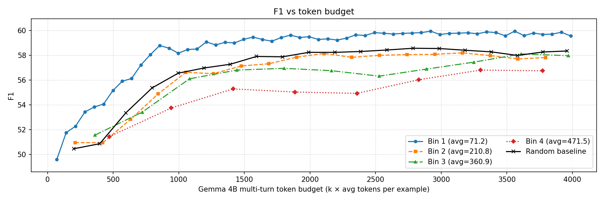
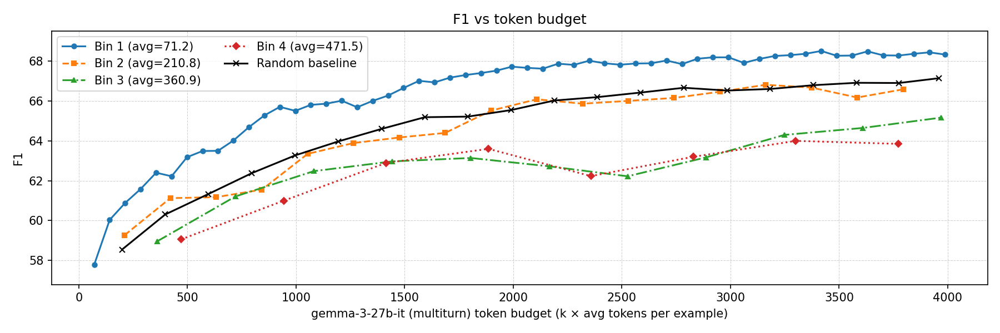
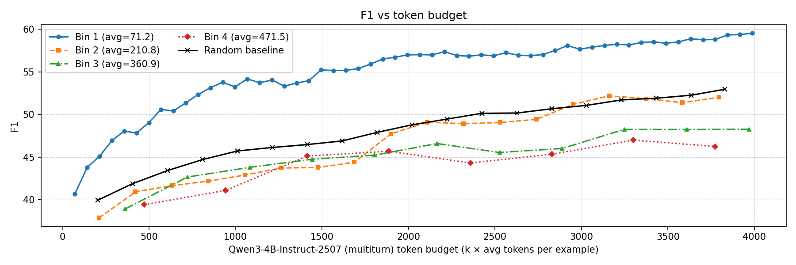
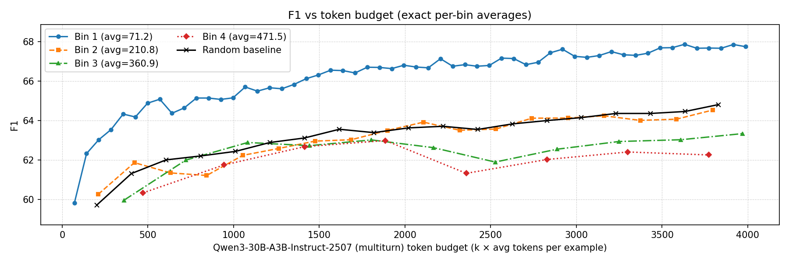
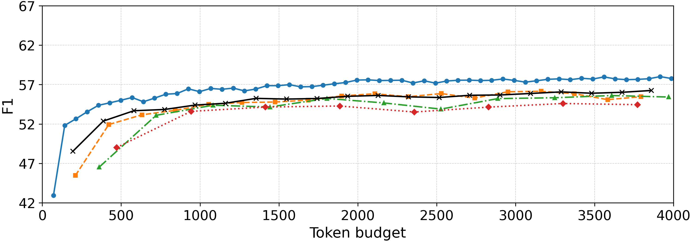
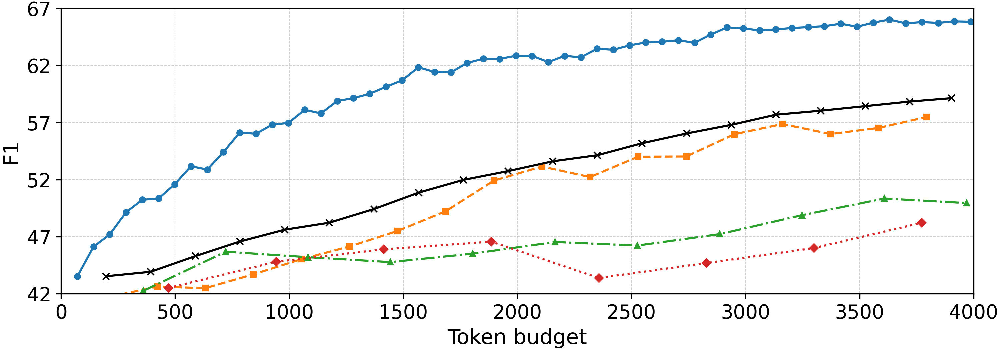

# Reproducibility Package: The ROI of Small Examples

Code for reproducing the experiments in the paper accepted in EACL 26 **"The ROI of Small Examples: Optimizing In-Context Learning Under Token Budgets"**, evaluated on **Beat the AI** and **Natural Questions (NQ)**.

## Overview

We study how the **token length of ICL examples** affects extractive QA performance on two main benchmarks: 1) Beat the AI, which is an adversarial dataset coming from the SQuAD 2.0 source dataset. 2) The Natural Questions (NQ) dataset. The pipeline:

1. **Data Preparation** — Compute token-length distributions of training examples using the Freedman–Diaconis rule, then extract stratified bins from an Elasticsearch index.
2. **Experiments** — Run three ICL conditions per dataset:
   - **Length-bin (stratified)**: Select ICL examples from specific token-length bins, filling a fixed token budget via multi-turn conversations.
   - **Random baseline**: Sample ICL examples uniformly at random from the full pool (5 runs with different seeds for variance estimation).
   - **Zero-shot**: No ICL examples; only the task instruction and the test query.
3. **Evaluation** — Compute F1, Exact Match (EM), NO\_ANSWER accuracy, and (for NQ) YES/NO accuracy against golden truth.
4. **Plotting** — Generate F1-vs-token-budget curves per bin, with optional random-baseline overlay.


**Gemma-3-4B**


**Gemma-3-27B**


**Qwen3-4B**


**Qwen3-30B**


**Phi-4B**


**Phi-14B**



## Repository Structure

```
reproducibility/
├── requirements.txt
├── beat-the-ai/
│   ├── data_preparation/
│   │   ├── config.py                                         # Elasticsearch & tokenizer config
│   │   ├── compute_length_distribution.py                     # Bin training examples by token length
│   │   └── extract_bin_examples.py                            # Extract examples per bin from ES
│   ├── experiments/
│   │   ├── beat_the_ai_length_bin_experiments_multiturn.py     # Length-bin ICL experiments
│   │   ├── beat_the_ai_random_baseline_multiturn.py           # Random baseline ICL experiments
│   │   └── beat_the_ai_zero_shot_experiments_multiturn.py     # Zero-shot experiments
│   ├── evaluation/
│   │   ├── evaluate_length_bin_results.py                     # Evaluate length-bin results
│   │   ├── evaluate_random_baseline_results.py                # Evaluate random baseline results
│   │   └── evaluate_zero_shot_results.py                      # Evaluate zero-shot results
│   └── plotting/
│       └── plot_length_bin_results.py                         # F1 vs token budget plots
├── nq/
│   ├── data_preparation/
│   │   ├── config.py                                  # Elasticsearch & tokenizer config
│   │   ├── compute_length_distribution.py             # Bin training examples by token length
│   │   ├── extract_bin_examples.py                    # Extract examples per bin from ES
│   │   └── build_golden_truth.py                      # Build golden truth from NQ dev set
│   ├── experiments/
│   │   ├── nq_length_bin_experiments_multiturn.py     # Length-bin ICL experiments
│   │   ├── nq_random_baseline_multiturn.py            # Random baseline ICL experiments
│   │   └── nq_zeroshot.py                             # Zero-shot experiments
│   ├── evaluation/
│   │   ├── evaluate_nq_length_bin_results.py          # Evaluate length-bin results
│   │   ├── evaluate_nq_random_baseline_results.py     # Evaluate random baseline results
│   │   └── evaluate_nq_zeroshot_results.py            # Evaluate zero-shot results
│   └── plotting/
│       └── plot_length_bin_results.py                 # F1 vs token budget plots
```

## Requirements

- Python ≥ 3.10
- GPU with ≥ 24 GB VRAM (for vLLM inference)
- Elasticsearch 8.x (for indexing training examples)

Install dependencies:

```bash
pip install -r requirements.txt
```

Key libraries: `vllm`, `transformers`, `torch`, `elasticsearch`, `more_itertools`, `numpy`, `matplotlib`.

## Models

Experiments were run with:

| Model | Parameters |
|---|---|
| `google/gemma-3-4b-it` | 4B |
| `google/gemma-3-27b-it` | 27B |
| `Qwen/Qwen3-4B` | 4B |
| `Qwen/Qwen3-30B-A3B-Instruct-2507` | 30B |

## Reproducing Experiments

### Step 1: Data Preparation

**Beat the AI:**

```bash
# Compute token-length distribution and bins
python beat-the-ai/data_preparation/compute_length_distribution.py

# Extract bin examples from Elasticsearch
python beat-the-ai/data_preparation/extract_bin_examples.py
```

**Natural Questions:**

```bash
# Compute token-length distribution and bins
python nq/data_preparation/compute_length_distribution.py

# Extract bin examples from Elasticsearch
python nq/data_preparation/extract_bin_examples.py

# Build golden truth for evaluation
python nq/data_preparation/build_golden_truth.py
```

### Step 2: Run Experiments

**Beat the AI** (token budget: 5,000):

```bash
# Length-bin experiments
python beat-the-ai/experiments/beat_the_ai_length_bin_experiments_multiturn.py \
    --bin-dir <bin_examples_dir> --token-budget 5000 --models google/gemma-3-4b-it

# Random baseline (5 runs)
python beat-the-ai/experiments/beat_the_ai_random_baseline_multiturn.py \
    --bin-dir <bin_examples_dir> --token-budget 5000 --num-runs 5

# Zero-shot
python beat-the-ai/experiments/beat_the_ai_zero_shot_experiments_multiturn.py \
    --models google/gemma-3-4b-it
```

**Natural Questions** (token budget: 30,000):

```bash
# Length-bin experiments
python nq/experiments/nq_length_bin_experiments_multiturn.py \
    --bin-dir <bin_examples_dir> --token-budget 30000 --models google/gemma-3-4b-it

# Random baseline (5 runs)
python nq/experiments/nq_random_baseline_multiturn.py \
    --bin-dir <bin_examples_dir> --token-budget 30000 --num-runs 5

# Zero-shot
python nq/experiments/nq_zeroshot.py --models google/gemma-3-4b-it
```

### Step 3: Evaluate

```bash
# Beat the AI length-bin (single run)
python beat-the-ai/evaluation/evaluate_length_bin_results.py --results-file <results.json>

# Beat the AI random baseline (5-run average)
python beat-the-ai/evaluation/evaluate_random_baseline_results.py \
    --results-file <run_1_results.json> --num-runs 5

# Beat the AI zero-shot
python beat-the-ai/evaluation/evaluate_zero_shot_results.py \
    --results-dir <zeroshot_results_dir>/

# NQ length-bin
python nq/evaluation/evaluate_nq_length_bin_results.py --results-file <results.json>

# NQ random baseline (5-run average)
python nq/evaluation/evaluate_nq_random_baseline_results.py \
    --results-file <run_1_results.json> --num-runs 5

# NQ zero-shot
python nq/evaluation/evaluate_nq_zeroshot_results.py \
    --results-dir <zeroshot_results_dir>/
```

### Step 4: Plot Results

```bash
# Beat the AI F1 vs token budget (with random baseline overlay)
python beat-the-ai/plotting/plot_length_bin_results.py data.json \
    --random random_data.json --legend --output beat_the_ai_results.pdf

# NQ F1 vs token budget
python nq/plotting/plot_length_bin_results.py data.json \
    --random random_data.json --legend --output nq_results.pdf
```

## Evaluation Metrics

| Metric | Description |
|---|---|
| **F1** | Token-level F1, max over all gold answers |
| **EM** | Exact match (after normalisation) |
| **NO\_ANSWER accuracy** | Fraction of unanswerable questions correctly predicted as `NO_ANSWER` |
| **YES/NO accuracy** | (NQ only) Accuracy on yes/no questions |
| **Long-only F1** | (NQ only) F1 for questions with only a long answer |


## Citation

If you use this code or build on our work, please cite:

Anxo Perez, Jorge Gabin, and Javier Parapar. 2027. **The ROI of Small Examples: Optimizing In-Context Learning Under Token Budgets.** In *Proceedings of the 20th Conference of the European Chapter of the Association for Computational Linguistics*, Athens, Greece. Association for Computational Linguistics. To appear.

```bibtex
@inproceedings{perez-etal-2027-roi,
    title = "The {ROI} of Small Examples: Optimizing In-Context Learning Under Token Budgets",
    author = "Perez, Anxo and
              Gabin, Jorge and
              Parapar, Javier",
    booktitle = "Proceedings of the 20th Conference of the {E}uropean Chapter of the {A}ssociation for {C}omputational {L}inguistics",
    year = "2027",
    address = "Athens, Greece",
    publisher = "Association for Computational Linguistics",
    note = "To appear"
}
```

*Provisional citation. The proceedings volume, editors, page numbers, and ACL Anthology link will be added when available.*


